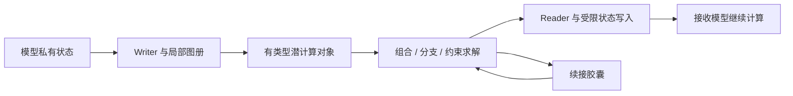

# 04｜机制图与海报源稿

## 八张机制图
F01 对象谱系：状态→算子/响应/信念/场/续接/图册。F02 算子组合：同输入，两种操作顺序，保持方向箭头。F03 响应包：锚点、方向基、有效邻域、刷新。F04 信念：三分支、权重更新、未知桶。F05 场：分源残差、共同状态、冲突支路。F06 续接：切点、时钟、待处理依赖、目标继续。F07 图册：局部映射、重叠、过渡、行为锚。F08 总架构：对象层、机制层、训练层、执行层。

每张图附不超过 120 字说明、一份可编辑矢量源、一份可插入文档的 PNG；图中虚构例子标“机制示意”。不把装饰性网格标成真实激活。

## 一页海报
标题：从潜空间通信到可组合潜计算。
中心主张：让模型间接口承载操作、分歧与计算进展。
左栏：三个思想实验；中栏：六旗舰机制；右栏：训练方式与 24 分支地图；底栏：本轮完整实现计划、未做模型实测、来源索引。

## 架构源

Mermaid 是结构源，不是最终设计质量保证。Dot 应用可用设计工具重排可读图，并保留图中语义与方向。
